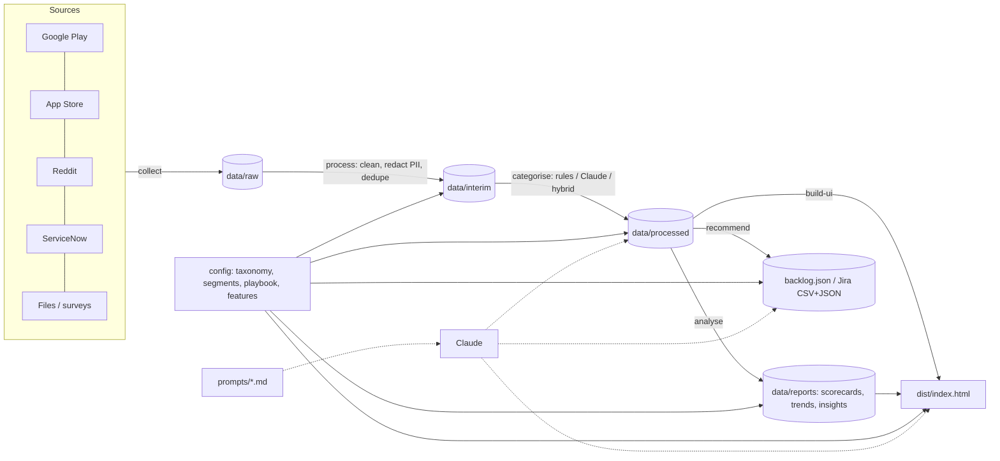

# Architecture

## Design principles
- **Modular:** one package per stage, one CLI verb per stage, one skill spec per stage.
- **File contracts:** CSV between stages (see `data-contract.md`) so any stage can be re-run, swapped or inspected in Excel.
- **Deterministic first, LLM second:** rules give free, reproducible labels; Claude handles ambiguous rows (`hybrid`).
- **Numbers from code:** scorecards and insights are computed; LLMs only narrate or draft.
- **Config over code:** taxonomy, segment rules, playbook text, competitor features and thresholds are data in `config/`.
- **Safe by default:** PII redaction before analysis, dry-run Jira, credentials only via `.env`.

## Extension points
| Want to... | Touch |
|---|---|
| Add a channel | `collect/<x>.py` + `registry.py` + `sources.yaml` + a recorded fixture test (`tests/test_collectors_fixtures.py`) |
| Add/rename a category | `taxonomy.json`, `playbook.json`, golden set |
| Add a metric | `analyse/metrics.py` (+ scorecard / UI export) |
| Add a tracker (ADO, ServiceNow) | `recommend/<tracker>.py` consuming `backlog.json` |
| Change the look | `ui/templates/app.css` |
| Swap the model | `settings.yaml > categorise.llm_model` |

## Hosting the UI
`dist/index.html` is static and self-contained (Chart.js and SheetJS are inlined from `src/ci/ui/vendor/`, so it works offline;
`ui.vendor_assets: false` or `ci build-ui --cdn` switches back to CDN links). Open it locally, host it on any static site, or publish it as an artifact.

## API
`src/ci/api/` (FastAPI, `ci serve`) is the backend the static UI needs for anything with a secret: `GET /backlog`, `POST /ingest`,
`POST /pipeline/run`, `POST /jira/push`. Mutations require `CI_API_KEY`; real Jira writes additionally require `CI_ALLOW_JIRA_PUSH=1`
and are dry-run by default. Stages are reused through `ci.pipeline.run_downstream`, so CLI and API behave identically.

## Incremental runs
`ci collect --incremental` (or `ci run --incremental`) merges into the newest `data/raw/comments_*.csv` using a stable key
(`bank|source|channel|id`, else a hash of date + text) and re-fetches `collect.overlap_days` before the newest stored date.
`.github/workflows/scheduled-run.yml` caches `data/raw` between weekly runs.
